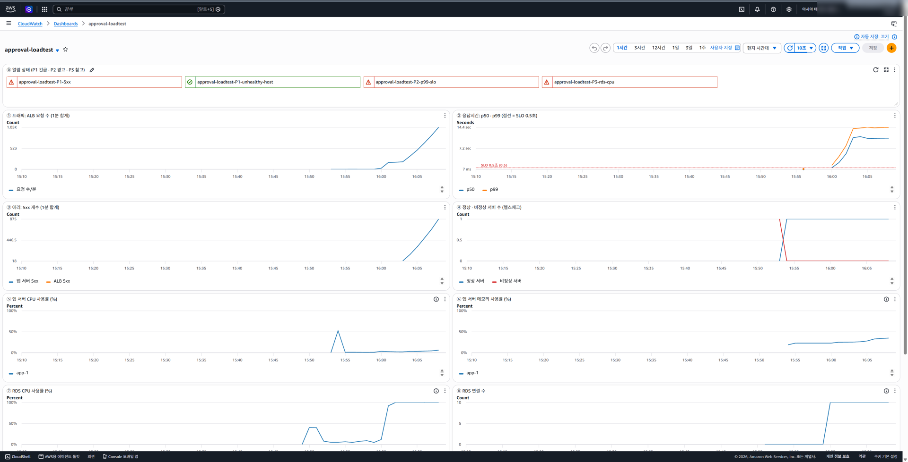
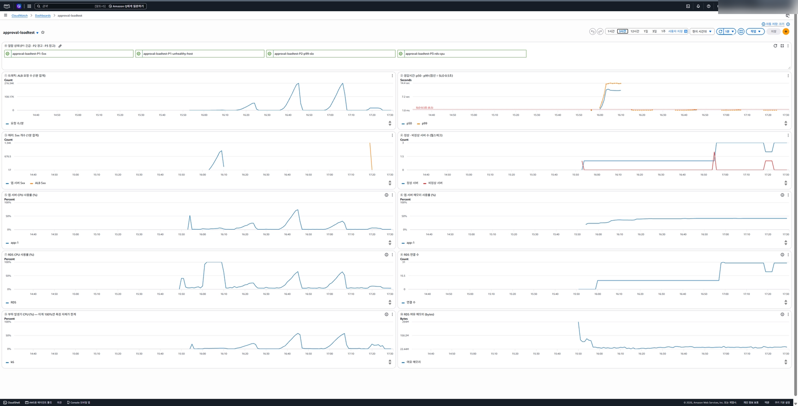

# 업무시스템 결재함 부하 테스트와 모니터링 (AWS)

직원 1만 명이 쓰는 사내 업무시스템의 **"내 결재함"** API를 AWS에 올리고, 부하 테스트로 **병목을 찾고 → 고치고 → 다시 재는** 과정을 직접 수행한 실습입니다. 성능만이 아니라 **모니터링(대시보드·알람)이 실제로 문제를 잡아내는지**, 서버 장애 때 **얼마나 빨리 알아채는지**까지 측정했습니다.

> 핵심 발견: **서버는 "정상"으로 판정되는데 사용자 요청의 68%가 실패**하는 상황을 실측했습니다. 좋은 모니터링은 서버가 아니라 사용자를 봐야 합니다.

## 결과 요약

| 단계 | 조건 | 처리량 | 응답시간 | 실패 | 병목 / 관찰 | 목표 |
|---|---|---|---|---|---|---|
| 1차 | 인덱스 없음, 서버 1대, 200명 | 약 18건/초에서 정체 | 중간값 10초 | **68.7%** | DB CPU 100%, 앱 CPU 약 5% | ✗ |
| 조치 | 복합 인덱스 생성 | | 단건 404ms → **10ms** | | 읽는 행 995,826 → **113** | |
| 2차 | 인덱스, 서버 1대, 200명 | 최고 약 950건/초 | 중간값 3.5ms | **0%** | 모든 칸 20%대 (부하 부족) | ✓ |
| 2b | 인덱스, 서버 1대, 800명 | 최고 약 3,600건/초 | p99 160ms | 0% | 앱 CPU 약 75%, DB 약 65% | ✓ |
| 3차 | 인덱스, **서버 3대**, 800명 | 최고 약 3,700건/초 | p99 **130ms** | 0% | 앱 CPU 대당 약 25~30%, DB 약 65% | ✓ |
| 장애 | 서버 3대 중 1대 정지 | 약 294건/초 유지 | p99 10ms | 1,353건 (1.28%) | **ALB 탐지 13.4초, 사람 알람 약 2분 30초** | |

목표(가정): 1만 명 × 출근 10분 × 결재함 3회 = 초당 50건 → 2배 여유 **초당 100건, p99 0.5초 이내, 실패 1% 미만**

**정리**
1. 병목은 DB였고, **DB 사양을 올리지 않고 인덱스 하나로** 처리 능력을 약 200배 늘렸습니다 (추가 비용 0).
2. 서버 1대 → 3대는 속도(p99 160 → 130ms)보다 **여유(CPU 75% → 25%)와 장애 대비** 효과가 컸습니다. 병목이 아닌 곳을 늘리면 체감 효과는 작습니다.
3. 서버 1대가 죽었을 때 **자동 조치(ALB)는 13초, 사람 호출(CloudWatch 알람)은 약 2분 30초**가 걸렸습니다. 14초의 장애만으로 해당 구간의 실패율이 목표(1%)를 넘었습니다.

자세한 분석은 [report.md](report.md), 실제 실행한 명령과 출력은 [commands.md](commands.md)에 있습니다.

## 구성

```
 [부하 발생기 EC2: k6] ──▶ [ALB] ──▶ [앱 서버 EC2 × 1~3: Spring Boot] ──▶ [RDS MySQL: 결재 문서 100만 건]
        │                                                                    ▲
        └────────────── 데이터 넣기 · 인덱스 만들기 (mysql) ─────────────────┘

 [CloudWatch 대시보드] 요청 수 · p50/p99 · 5xx · 정상/비정상 서버 · 앱 CPU/메모리 · RDS CPU/연결/메모리 · 부하 발생기 CPU
 [CloudWatch 알람]     P1 긴급(비정상 서버, 5xx) · P2 경고(p99 SLO 초과) · P3 참고(DB CPU 80%)
```

| 구성 요소 | 내용 |
|---|---|
| 앱 | Spring Boot 3 (Java 21), 내장 Tomcat, HikariCP 풀 10. `GET /api/approvals/inbox` (95%), `POST /api/approvals` (5%), `GET /health` (DB 안 거침) |
| 인프라 | Terraform: ALB, EC2 t3.small × `app_count`, RDS MySQL 8.0 db.t3.micro, 부하 발생기 EC2 t3.medium, S3, IAM, CloudWatch 대시보드·알람 4개 (약 58개 리소스) |
| 부하 | k6 v0.52. 사용자를 10% → 50% → 100%로 늘리며 9분 30초. 응답 헤더 `X-Server-Name`으로 서버별 처리 건수 집계 |
| 장애 테스트 | `fail-test.sh`: 부하 중 앱 서버 1대를 SSM으로 정지 → ALB 판정(1초 간격)·알람 상태(5초 간격)를 기록 → 재시작 후 복구 시간 측정 |
| 보안 설계 | 계층별 보안 그룹(바로 앞 계층만 허용), RDS 외부 차단, SSH 없이 Session Manager, 앱 서버와 부하 발생기의 IAM 역할 분리(최소 권한), tfstate·tfvars 커밋 제외 |

## 대표 화면

1차 테스트 중: 헬스체크(P1-unhealthy-host)는 **정상(초록)**인데 5xx·p99·DB CPU 알람은 **빨강**



전체 흐름 (1차 → 2차 → 2b → 3차 → 장애 테스트, 3시간)



## 폴더 구조

```
app/        Spring Boot 결재함 API
infra/      Terraform (네트워크·보안 그룹, EC2, ALB, RDS, S3, IAM, 대시보드, 알람)
loadtest/   부하 발생기 스크립트 (seed, explain, create-index, run-test + script.js, fail-test + failover.js, report.py)
results/    k6 HTML 리포트와 요약 JSON (테스트별)
docs/       실행 가이드(GUIDE.md), 캡처 이미지
```

## 직접 실행해 보기

준비물(AWS CLI, Terraform, Docker)부터 정리까지 단계별 안내는 [docs/GUIDE.md](docs/GUIDE.md)에 있습니다.

```powershell
# 1. 앱 빌드 (Docker)
cd app; docker run --rm -v "${PWD}:/src" -w /src maven:3.9.9-eclipse-temurin-21 mvn -q -B package -DskipTests
# 2. 인프라 생성 (my_ip 입력 필요)
cd ..\infra; Copy-Item terraform.tfvars.example terraform.tfvars; terraform init; terraform apply
# 3. 부하 발생기(Session Manager)에서: ./seed.sh → ./run-test.sh 1-no-index → ./create-index.sh → ...
# 4. 끝나면 반드시 삭제
terraform destroy
```

> ⚠️ 실행하면 AWS 요금이 나옵니다 (이번 실습 약 2시간 30분, 대략 1달러 안팎). 끝나면 반드시 `infra` 폴더에서 `terraform destroy`를 실행하세요.

## 관련 실습

클라우드 컴퓨팅 수업 실습의 다음 단계로 진행했습니다.

- [aws-02 EC2+ALB](https://github.com/hahyunnii/aws-02-ec2-alb-hahyunnii): 헬스체크 30초 × 2회라 서버 장애 탐지가 늦었던 경험 → 이번에는 10초 × 2회로 줄이고 탐지 시간을 실측
- [aws-04 ab 벤치마크](https://github.com/hahyunnii/aws-04-benchmark-using-ab-hahyunnii): 부하가 한계에 가까우면 p95가 먼저 오른다 → 이번 2b 테스트에서도 같은 신호 확인
- [aws-05-2](https://github.com/hahyunnii/aws-05-2-wp-with-ha-setting-hahyunnii), [aws-06](https://github.com/hahyunnii/aws-06-ec2-rds-with-terraform-hahyunnii): 계층별 보안 그룹 체인, EC2+RDS 분리 구조를 그대로 이어받음
- [final-project-wordpress-ha](https://github.com/hahyunnii/final-project-wordpress-ha): CPU 70% × 4분 자동 확장 알람이 짧은 테스트에서는 동작하지 않았던 경험 → 이번에는 알람이 울리는 시간을 직접 측정
