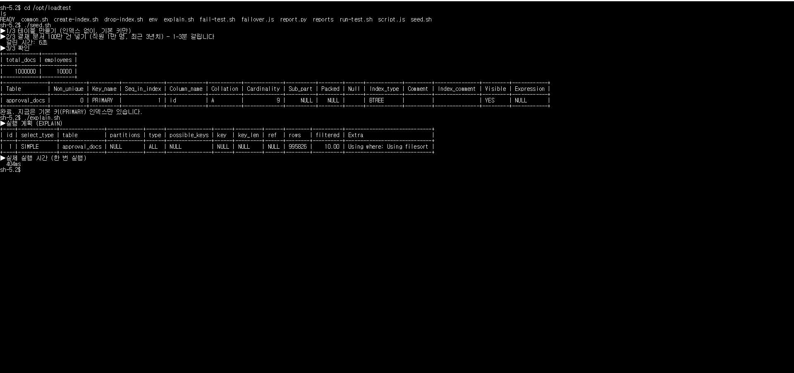
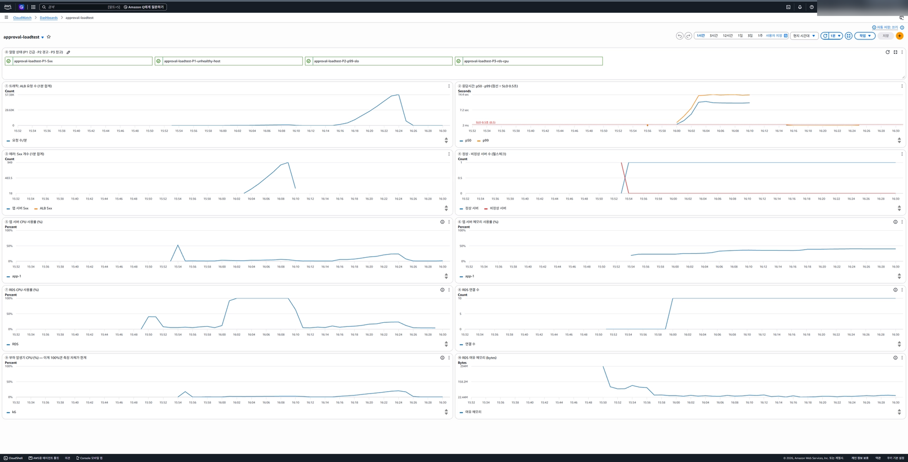
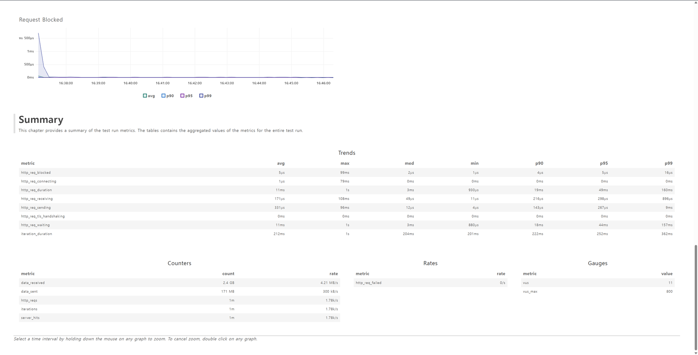
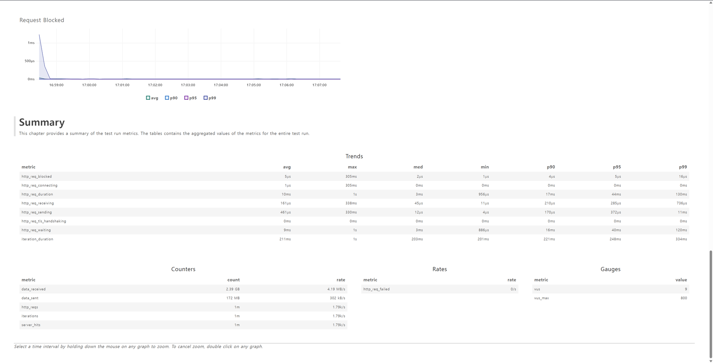
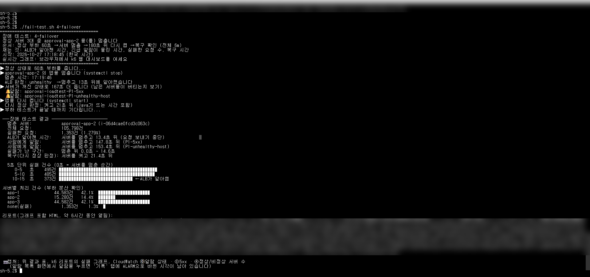
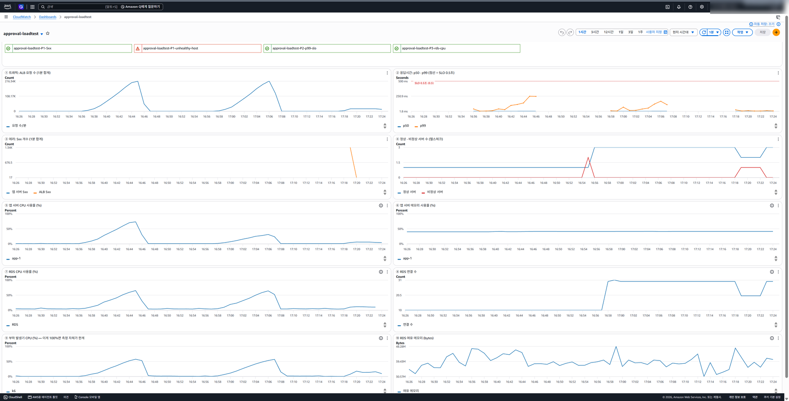

# Report — 업무시스템 결재함 부하 테스트와 모니터링 (AWS)

- 작성자: 이하현
- 실습 일시: 2026-10-27 15:45 ~ 17:40 (KST)
- 리전: ap-northeast-2 (서울)
- 실행 기록: [commands.md](commands.md), 실행 가이드: [docs/GUIDE.md](docs/GUIDE.md)

---

## 1. 목적

"직원 1만 명이 쓰는 사내 업무시스템을 어떻게 모니터링할 것인가"를 설계하면서, **그 모니터링이 실제로 문제를 잡아내는지** AWS에서 검증하려고 진행했습니다.

부하 테스트 강의의 흐름을 그대로 따랐습니다.

```
① 목표 정하기 → ② 최대 처리량 측정 → ③ 모니터링으로 병목 찾기 → ④ 개선 → ⑤ 다시 측정 (목표까지 반복)
```

여기에 모니터링 관점의 질문 두 가지를 더했습니다.
- 서버가 고장 나면 **몇 초 만에 알아채는가**, 그동안 사용자는 얼마나 피해를 보는가
- **알람**은 사람에게 언제 도착하는가

## 2. 목표 (가정)

| 항목 | 값 | 근거 |
|---|---|---|
| 처리량 | 초당 100건 | 직원 1만 명 × 출근 10분(600초) 동안 결재함 3회 = 3만 건 ÷ 600초 = 초당 50건, 순간 집중을 고려해 2배 |
| 응답시간 | 결재함 조회 **p99 0.5초 이내** | 평균은 소수 사용자의 큰 지연을 숨기므로 p99 사용 |
| 실패율 | 1% 미만 | |

> 위 숫자는 실제 회사 데이터가 아닌 **가정**입니다. k6 threshold로 넣어 테스트가 끝나면 ✓/✗로 판정되게 했습니다.

## 3. 구성

```
 [부하 발생기 EC2: k6] ──▶ [ALB] ──▶ [앱 서버 EC2 × 1~3: Spring Boot] ──▶ [RDS MySQL: 결재 문서 100만 건]
        │                                                                    ▲
        └────────────── 데이터 넣기 · 인덱스 만들기 (mysql) ─────────────────┘
```

| 계층 | 사양 | 비고 |
|---|---|---|
| 부하 발생기 | EC2 t3.medium, k6 v0.52 | **앱 서버와 다른 컴퓨터**에서 부하. 자신의 CPU도 대시보드에서 감시 |
| ALB | 헬스체크 `/health`, **10초 간격, 2회 연속 실패 시 제외** | `/health`는 DB를 거치지 않음 (서버 생존만 판정) |
| 앱 서버 | EC2 t3.small × `app_count` (1 → 3), Java 21, Spring Boot 3, HikariCP 풀 10 | 응답 헤더 `X-Server-Name`으로 처리한 서버 표시 |
| DB | RDS MySQL 8.0 db.t3.micro, 결재 문서 100만 건 (직원 1만 명, 3년치) | 외부 접근 차단, 앱·부하 발생기 보안 그룹에서만 3306 허용 |

**API**
- `GET /api/approvals/inbox?approverId=` — 내 결재함 최신 20건 (요청의 95%)
  `WHERE approver_id = ? ORDER BY created_at DESC LIMIT 20`
- `POST /api/approvals` — 결재 상신 (5%)

**모니터링**

| 대시보드 칸 | 지표 | 보는 이유 |
|---|---|---|
| ① ② ③ | ALB 요청 수, p50·p99 응답시간, 5xx | 사용자가 겪는 것 (트래픽·지연·에러) |
| ④ | 정상·비정상 서버 수 | 장애 탐지 |
| ⑤ ⑥ | 앱 서버 CPU·메모리 | 앱 계층 포화도 |
| ⑦ ⑧ ⑩ | RDS CPU·연결 수·여유 메모리 | DB 계층 포화도 |
| ⑨ | 부하 발생기 CPU | 측정 자체를 믿을 수 있는지 |

| 알람 | 조건 | 등급 |
|---|---|---|
| `P1-unhealthy-host` | 비정상 서버 > 0 (1분) | 긴급: 지금 서버가 죽었다 |
| `P1-5xx` | 5xx(ALB + 앱) > 10건/분 | 긴급: 사용자가 지금 실패를 겪는다 |
| `P2-p99-slo` | p99 > 0.5초, 3분 연속 | 경고: 목표를 못 지킨다 |
| `P3-rds-cpu` | DB CPU > 80%, 5분 연속 | 참고: 여유가 없다 (용량 계획) |

**보안 설계** (직접 구성)
- 보안 그룹 체인: 내 IP·부하 발생기 → ALB(80) → 앱(8080) → RDS(3306). 각 계층은 바로 앞 계층만 허용
- SSH 포트를 열지 않고 Session Manager로 접속
- IAM 역할 분리: 앱 서버는 jar 읽기만, 부하 발생기는 스크립트·리포트와 장애 테스트에 필요한 권한만 (SSM 명령은 이 실습의 앱 서버 ARN으로 한정)
- DB 비밀번호가 들어 있는 `terraform.tfstate`, `terraform.tfvars`는 `.gitignore`로 커밋 제외

## 4. 테스트 방법

| 테스트 | 시나리오 |
|---|---|
| 단계별 부하 (`run-test.sh`) | 가상 사용자를 최대치(MAX_VUS)의 10% → 50% → 100%로 늘려 9분 30초. 사용자마다 요청 후 0.2초 쉼. 최대 처리량 = k6 요청 수 그래프가 평평해진 높이 |
| 장애 (`fail-test.sh`) | 사용자 60명으로 일정하게 6분. 60초 뒤 앱 서버 1대를 `systemctl stop`(SSM), 180초 뒤 `systemctl start`. ALB 판정을 1초마다, P1 알람 상태를 5초마다 기록. 실패 시각은 k6 CSV(밀리초)에서 계산 |

## 5. 결과

| 단계 | 조건 | 요청 수 | 처리량 | 응답시간 | 실패 | 목표 |
|---|---|---|---|---|---|---|
| 1차 | 인덱스 없음, 서버 1대, 최대 200명 | 5,248 | **약 18건/초에서 정체** | med 10s, p95 13.7s | **68.7%** | ✗ |
| 2차 | 인덱스, 서버 1대, 최대 200명 | 262,536 | 평균 460, 최고 약 950건/초 | med 3.5ms, p95 6.5ms | 0% | ✓ |
| 2b | 인덱스, 서버 1대, 최대 800명 | 1,014,634 | 평균 1,780, 최고 약 3,600건/초 | med 3ms, p95 49ms, **p99 160ms** | 0% | ✓ |
| 3차 | 인덱스, 서버 3대, 최대 800명 | 1,022,608 | 평균 1,790, 최고 약 3,700건/초 | med 3ms, p95 44ms, **p99 130ms** | 0% | ✓ |
| 장애 | 서버 3대, 60명 일정, 1대 정지 | 105,798 | 약 294건/초 유지 | p99 10ms | 1,353건 (1.28%) | |

CloudWatch에서 읽은 계층별 최고치 (그래프 판독이라 "약"으로 표기)

| 단계 | ⑤ 앱 CPU | ⑦ RDS CPU | ⑧ RDS 연결 | ⑨ 부하 발생기 CPU | 100%에 붙은 칸 |
|---|---|---|---|---|---|
| 1차 | 약 5% | **100%** | 10 (최대) | 약 3% | **⑦ DB** |
| 2차 | 약 25% | 약 22% | 10 | 약 20% | 없음 (부하 부족) |
| 2b | **약 75%** | 약 65% | 10 | 약 55% | 없음 (앱이 가장 높음) |
| 3차 | 대당 약 25~30% | 약 65% | **30** | 약 55% | 없음 |

장애 테스트

| 항목 | 결과 |
|---|---|
| ALB가 알아챈 시간 | **13.4초** (이론 10~20초) |
| 실패 구간 / 건수 | 정지 후 0.0~14.6초, 1,353건 (5초당 약 400~500건 ≈ 전체의 1/3) |
| 사람에게 알람 | P1-5xx **147.8초**, P1-unhealthy-host **153.4초** |
| 다시 켠 뒤 정상 판정 | 21.4초 (Java 기동 포함) |
| 서버별 처리 | app-1 42.1%, app-2(정지) 14.4%, app-3 42.1% |

## 6. 분석

### 6.1 병목 찾기: 서버는 정상인데 사용자는 실패 (1차)


같은 시각의 그래프를 위아래로 비교하면 원인이 보입니다.

> 요청이 늘었다(①) → 응답시간이 14초까지 올랐다(②) → 앱 CPU는 5%로 한가하고(⑤) DB CPU는 100%에 붙었다(⑦) → **병목은 DB**

실행 계획(`EXPLAIN`)이 이유를 보여줬습니다. 결재함을 열 때마다 **약 100만 건을 전부 읽고 정렬**(`type=ALL`, `Using filesort`)하고 있었습니다.



실패한 요청의 중간값이 **정확히 10초**였습니다. 앱 서버는 DB 연결을 10개만 갖고 있고(⑧이 10에 고정), 연결을 10초 안에 못 받으면 에러를 내도록 설정돼 있습니다. 느린 쿼리가 연결 10개를 모두 붙잡고 있으니 뒤에 선 요청이 10초를 기다리다 실패한 것입니다.

가장 중요한 장면은 알람 칸입니다. **P1-5xx, P2, P3는 빨강인데 P1-unhealthy-host는 초록**이었습니다. 헬스체크(`/health`)는 DB를 거치지 않으므로 서버는 "살아 있다"고 판정됐지만, 실제 사용자 요청은 68%가 실패했습니다. **헬스체크만 감시했다면 이 장애를 놓쳤을 것**입니다. 사용자가 겪는 지표(5xx, p99)를 함께 봐야 하는 이유입니다.

부하 발생기 CPU(⑨)는 약 3%로 여유가 있어, 이 결과는 측정 도구의 한계가 아닙니다.

### 6.2 조치: 쿼리 개선 (인덱스)

강의의 "DB가 병목이면 쿼리 개선부터"에 따라 `(approver_id, created_at)` 복합 인덱스를 만들었습니다 (6초 소요).

| | 전 | 후 |
|---|---|---|
| 실행 계획 | ALL, 995,826행, filesort | ref, **113행**, Backward index scan |
| 단건 실행 | 404ms | **10ms** |
| 2차 테스트 | 실패 68.7% | **실패 0%**, med 3.5ms |
| DB CPU | 100% | 약 22% |

**DB 사양을 올리지 않고 추가 비용 없이** 목표를 달성했습니다. 사양만 올렸다면 데이터가 늘어날 때 같은 문제가 다시 생겼을 것입니다. 대응을 "비용이 적은 순"(쿼리 → 캐시 → Read Replica → 사양)으로 해야 하는 이유입니다.



### 6.3 한계 다시 찾기 (2b)

2차는 모든 칸이 20%대였고 처리량이 끝까지 오르기만 했습니다. 시스템이 아니라 **부하가 부족**했던 것이라, 사용자를 4배(800명)로 늘렸습니다.

- 최고 약 3,600건/초까지 실패 없이 처리 → 1차의 약 18건/초 대비 **약 200배**
- 앱 CPU 약 75%가 가장 높고, DB 약 65%
- p99가 가끔 200~800ms로 튀기 시작 → **응답시간 꼬리(p99)가 먼저 흔들리는 것은 한계에 다가가는 신호**입니다 (수업 aws-04 벤치마크에서 p95가 처리량보다 먼저 오른 것과 같은 현상)



### 6.4 수평 확장: 무엇이 좋아졌나 (3차)

가장 바쁜 앱 서버를 1대 → 3대로 늘리고 같은 800명으로 비교했습니다.

| | 서버 1대 (2b) | 서버 3대 (3차) |
|---|---|---|
| p95 / p99 | 49ms / 160ms | 44ms / 130ms |
| 앱 CPU (app-1) | 약 75% | 약 25~30% |
| RDS CPU | 약 65% | 약 65% |
| RDS 연결 수 | 10 | 30 |

**속도는 조금만 좋아졌습니다.** 서버 1대일 때 앱 CPU가 75%로 아직 병목이 아니었기 때문입니다. 병목을 고친 인덱스(응답 10초 → 3ms)와 비교하면 **병목이 아닌 곳을 늘리면 체감 효과가 작다**는 것이 분명합니다.

대신 효과는 두 가지로 나타났습니다.
1. **여유**: 앱 CPU가 75% → 25~30%로, 예상보다 몇 배 많은 피크도 버틸 수 있습니다.
2. **장애 대비**: 6.5에서 확인합니다.

남은 관찰도 있습니다.
- **DB는 그대로 약 65%** → 부하가 더 늘면 다음 병목은 다시 DB입니다. 다음 조치는 캐시나 Read Replica입니다 (이번에는 설계만 했습니다).
- **RDS 연결 수가 10 → 30**(서버 3대 × 풀 10)으로 늘었습니다. 서버를 늘리면 DB 연결도 곱으로 늘기 때문에, 풀 크기를 무작정 키우면 DB의 최대 연결 수를 넘을 수 있습니다.



### 6.5 장애: 자동 조치는 초, 사람 호출은 분



서버 3대 중 app-2를 멈췄습니다.

1. **ALB는 13.4초 만에** 고장 서버를 뺐습니다. 설정(10초 × 2회)의 이론값 10~20초 안입니다. 그동안 요청의 약 1/3(죽은 서버 몫)이 실패했고, 뺀 뒤에는 실패가 0이 됐습니다. 처리량은 약 294건/초로 유지돼 남은 2대가 부하를 받아냈습니다.
2. **사람에게 알람은 약 2분 30초 뒤**에 울렸습니다. CloudWatch 알람은 1분 단위로 모인 지표를 보고 판단하기 때문입니다.
3. **14초의 장애만으로 해당 6분 구간의 실패율이 1.28%**가 되어 목표(1% 미만)를 넘었습니다. 탐지 시간이 곧 사용자 피해이고, SLO(에러 버짓)를 얼마나 쓰는지를 결정합니다.

그래서 모니터링의 역할을 나눠야 합니다.
- **피해를 멈추는 것**은 자동 조치가 초 단위로 (ALB 헬스체크, Auto Scaling)
- **원인을 고치는 것**은 사람이 분 단위로 (알람 → 대시보드 → 런북)

수업 aws-02에서는 헬스체크가 30초 × 2회라 탐지가 최대 60초였고 요청 5건 중 3건이 응답하지 않았습니다. 간격을 10초로 줄인 이번 설정에서는 탐지가 13.4초였습니다.

서버가 1대였다면 정지한 동안 결재함 전체가 실패했을 것입니다 (**추정**, 측정하지 않음). 3대여서 1/3만, 14초 동안만 실패했습니다. 6.4에서 본 수평 확장의 두 번째 효과입니다.



### 6.6 헛알람

서버를 1대 → 3대로 늘린 직후, 새 서버가 Java를 설치하고 뜨는 동안 헬스체크에 실패해 **P1-unhealthy-host 알람이 울렸습니다.** 장애가 아닌데 긴급 알람이 울린 것입니다. 헛알람이 잦으면 사람들이 알람을 무시하게 되므로, 실무에서는 Auto Scaling의 health check grace period로 기동 중인 서버를 판정에서 제외합니다.

## 7. 결론

| 강의 흐름 | 이번 실습 |
|---|---|
| 목표 설정 | 초당 100건, p99 0.5초, 실패 1% 미만 (가정) |
| 최대 처리량 측정 | 약 18건/초에서 정체 |
| 병목 찾기 | DB CPU 100%, 앱 5% → DB. 실행 계획 ALL·100만 행 |
| 개선 | 복합 인덱스 (비용 0) |
| 재측정 | 실패 0%, 최고 약 3,600건/초 이상 → **목표 달성** |
| (반복) 다음 병목 | 앱 CPU 75%가 가장 높아 수평 확장 → 속도 효과는 작고 여유·장애 대비 효과가 큼. 다음 병목 후보는 DB(65%) |

1. **병목은 DB였고, 인덱스 하나로 해결했습니다.** 강의는 "DB → 인덱스 → EC2 → 수평 확장" 순서였지만, 이번 시스템에서는 인덱스 이후 두 번째 병목이 실제로 나타나지 않았습니다. 그래프가 보여준 대로 판단했습니다.
2. **서버 증설의 목적은 속도가 아니라 여유와 장애 대비**였습니다. 목표는 서버 1대로도 달성했으므로, 비용을 생각하면 증설은 "피크 여유와 가용성이 필요한 만큼"만 하는 것이 맞습니다.
3. **모니터링은 서버가 아니라 사용자를 봐야 합니다.** 헬스체크는 초록인데 사용자 68%가 실패한 1차 장면, 14초 장애가 목표를 깬 장애 테스트가 그 근거입니다.

## 8. 한계

- **같은 리전 안에서 부하**: 부하 발생기와 서버가 같은 VPC라 실제 사용자의 인터넷 구간 지연은 포함되지 않습니다.
- **단순한 데이터와 요청**: 결재 문서와 직원 번호를 무작위로 분포시켰고, 요청은 조회 95% · 상신 5% 두 가지뿐입니다. 실제 업무시스템의 다양한 화면·로그인·파일 첨부는 없습니다.
- **가장 작은 사양**: t3 계열(CPU 크레딧 방식)과 db.t3.micro라 절대 숫자는 실제 운영 환경과 다릅니다. 결론은 절대 숫자가 아니라 **현상**(병목 이동, 탐지 시간, 알람 지연)입니다.
- **2차 테스트의 p99 미기록**: k6 요약에 p90·p95만 출력돼 2차의 정확한 p99는 없습니다 (threshold `p(99)<500`은 통과).
- **800명 테스트의 k6 종료 문제**: 요청 약 100만 건 테스트가 끝난 뒤 k6가 터미널 요약 출력 단계에서 멈췄습니다. 메모리 부족은 아니었고 원인은 확인하지 못했습니다. HTML 리포트는 정상 생성돼 이를 사용했고, 서버별 처리 비율은 CloudWatch로 확인했습니다.
- **대시보드 표시**: 서버 증설 후 ⑤⑥ 칸에 app-1 한 줄만 보였습니다. app-1 한 대의 CPU 변화로 비교했습니다.
- **설계만 한 것**: 캐시(ElastiCache), Read Replica, CloudFront+S3(정적 파일), 실제 사용자 측정(RUM), 정기 점검(Synthetic), 보안 이벤트 탐지(CloudTrail, GuardDuty, WAF)는 구성하지 않았습니다.
- **서버 1대 장애의 영향**은 측정하지 않고 추정했습니다.

## 9. 다음에 해볼 것

- 캐시(ElastiCache) 또는 Read Replica를 넣고 같은 800명 부하에서 DB CPU 비교
- 헬스체크 간격을 5초로 줄였을 때 탐지 시간과 실패 건수 변화
- 알람을 더 빨리 받는 방법 비교: Synthetic 점검, 지표 수집 주기
- Auto Scaling Group + grace period로 헛알람 없이 자동 확장되는지 확인

## 10. 비용과 정리

- 사용 시간 약 2시간 30분 (t3.small 1~3대, t3.medium 1대, db.t3.micro, ALB, CloudWatch 알람 4개). 예상 비용 약 1달러 안팎 (정확한 금액은 Billing에서 확인)
- `terraform destroy`로 58개 리소스 삭제 완료
- [ ] IAM 액세스 키(`terraform-lab`) 비활성화·삭제

## 부록: 캡처 목록 (`docs/images/`)

| 파일 | 내용 |
|---|---|
| 01-seed-explain-before.png | 100만 건 생성, 인덱스 전 실행 계획 (ALL, 995,826행, 404ms) |
| 02a-test1-cloudwatch-during.png | 1차 테스트 중: 알람 3개 빨강, unhealthy 초록, RDS CPU 100% |
| 02-test1-cloudwatch.png | 1차 테스트 직후 전체 대시보드 |
| 03-test1-k6.png | 1차 k6: 처리량 정체, 응답시간 14초 |
| 04-test2-cloudwatch.png | 2차: 응답시간 바닥, 모든 칸 20%대, 알람 초록 |
| 05-test2b-cloudwatch.png | 2b: 앱 CPU 약 75%, RDS 약 65% |
| 06-test2b-k6-summary.png | 2b k6 Summary (p99 160ms) |
| 07-test3-cloudwatch.png | 3차: app-1 CPU 약 30%, RDS 연결 30 |
| 08-test3-k6.png, 09-test3-k6-summary.png | 3차 k6 그래프와 Summary (p99 130ms) |
| 10-failover-terminal.png | 장애 테스트 결과표 |
| 11-failover-cloudwatch.png | 장애: 정상 서버 3→2→3, ALB 5xx 급증, P1 알람 |
| 12-failover-k6.png, 13-failover-k6-summary.png | 장애 k6 그래프와 Summary |
| 14-overview-3h-cloudwatch.png | 1차부터 장애 테스트까지 3시간 전체 |
